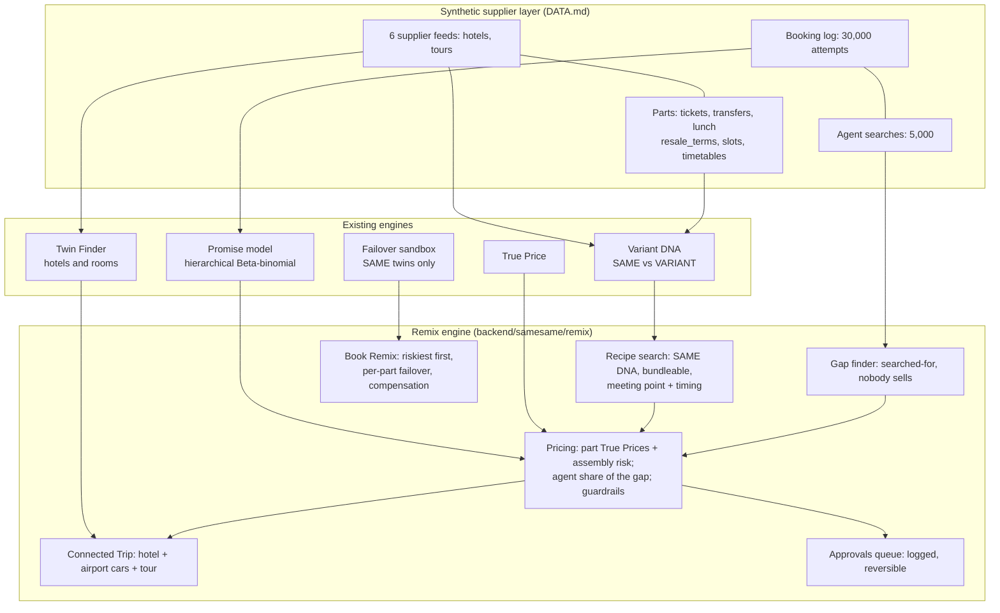

# Remix

**Remix makes new products from parts suppliers already sell.**

Remix splits every supplier's tour into parts (entry ticket, transfers, lunch) and assembles TBO's own version from the cheapest *reliable* parts across suppliers. A Remix is published only if it is all of these:
- the **SAME** experience as a package, by Variant DNA, or something agents search for that **nobody sells**;
- **cheaper on True Price**, not just sticker;
- leaves TBO a **margin**;
- clears a **Promise** floor;
- **approved by a person**.

Where the package is cheaper, Remix says so.

Built for the TBO Tek hackathon, Track 2 (Multi-supplier Inventory), Dubai. All supplier data is **synthetic**; hotels and attractions are real (OpenStreetMap, Wikimedia, Wikipedia).

## How it works



- **Recipe search:** for each packaged product, try every ticket × outbound car × return car (× lunch voucher). Keep only bundleable parts that are SAME on every field the package states, drop off at the ticket's meeting point, and arrive ≥ 20 min before the slot. Then take the cheapest assembly that passes every guardrail.
- **Pricing:**
  - TBO's cost = each part's True Price (sticker + price-change + failover risk, from its supplier's fitted Promise) + assembly risk (unwind and buy the package).
  - The agent's True Price = sell price + cancellation risk under the strictest part's rule.
  - The agent gets a share of the gap; TBO keeps the rest.
- **Results** (METRICS.md, rebuilt every build):
  - **4 of 30** multi-part packages pass every guardrail. Agents save 4.0–11.9% and TBO keeps 4.1–13.5%.
  - The package is cheaper in 7, and they're listed.
  - **18** gap Remixes pass, out of 78 combinations agents searched for that nobody sells.

Docs: [DEMO.md](DEMO.md) (4-minute script) · [QA.md](QA.md) · [METRICS.md](METRICS.md) · [DATA.md](DATA.md) · [PROGRESS.md](PROGRESS.md) · [REMIX_PLAN.md](REMIX_PLAN.md). The Python package keeps its original name, `samesame`.

## Run it

Requirements: Python 3.11+ and Node.js 18+. First run needs network; after that it runs fully offline.

macOS / Linux:
```bash
python3 start.py
```

Windows (PowerShell):
```powershell
py start.py
```

| Command (Windows: `py` instead of `python3`) | What it does |
|---|---|
| `python3 start.py` | dev: API on :8000, UI on :5173 with hot reload |
| `python3 start.py --demo` | stage mode: builds the UI once and serves everything from http://localhost:8000 |
| `python3 start.py --rebuild` | re-run the data/model pipeline |
| `python3 start.py --test` | run backend tests |
| `python3 start.py --skip-install` | offline start, no pip/npm |

**macOS + LightGBM:** if `lightgbm` fails to import, run `brew install libomp`. `start.py` also tries an automatic venv-only fallback that uses the libomp bundled with scikit-learn.

**LLM (optional):** set `LLM_API_KEY` (and optionally `LLM_MODEL`, default `anthropic/claude-haiku-5-5`). Without a key, everything still runs: gray-zone pairs go to the human review queue, extraction is rules-only, and diff sentences use templates. The pills at the top right of every page show which mode is active.

## Data provenance and licences

- Hotel base truth, river, roads and district outlines: © OpenStreetMap contributors, licensed under the [ODbL 1.0](https://opendatacommons.org/licenses/odbl/). Snapshot in `data/raw/osm/` (see `SNAPSHOT.txt` for timestamps and queries). Pulled once with `backend/scripts/pull_osm.py`.
- Supplier feeds, room names, offers, activities, **Remix parts (tickets, transfers, lunch vouchers, airport cars), booking logs and agent searches**: synthetic, generated with a fixed seed by `python -m samesame.pipeline` (~25 s; `start.py` runs it when needed). Part prices come from disclosed tariffs (DATA.md), set before any Remix result was computed.
- Images: Wikimedia Commons photos (credited, licences in `data/raw/wiki`), stock photos labelled "not this exact place", and procedural fallbacks labelled "illustrative".
- **[DATA.md](DATA.md)** lists exactly what is real, what is synthetic, and the few fixed inputs (the brief's golden-case offers).
- The first build downloads the MiniLM sentence-embedding model (87 MB) into `data/models/` once; after that everything runs offline. Without network the matcher drops that one feature and records it in `data/build/matcher.json`.
- **Matcher quality:** [METRICS.md](METRICS.md) is regenerated on every build from the frozen blind set in `data/blind/`. Teammates label that set (without seeing the model's answer) at http://localhost:8000/label.

**Honest limitations:** see the caveats in METRICS.md and the Remix decisions in PROGRESS.md.
