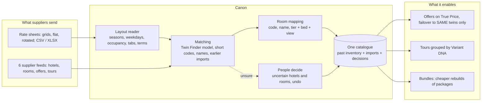

# Canon

**Every supplier sheet, one clean catalogue.**

TBO buys the same hotels and tours from many suppliers. Each supplier sends rate sheets in its own layout and names the same hotel and room its own way ("Hyatt Place", "HP", "HYATT PLACE DXB"; "HP SUP KG CV", "Superior Room, 1 King Bed"). Canon turns all of it into one catalogue:

1. **Import any rate sheet** (Catalogue → Import sheets). CSV or Excel, in the layouts suppliers really send:
   - **price grids**: a block per hotel, seasons across, Sun–Wed / Thu–Sat and SGL / DBL sub-columns, a room-code column, extra-guest columns, one tab per rate plan (base, "5 Nts+", "6% OFF"), several hotels per sheet, merged headers;
   - **one row per rate** (hotel, room, price columns found by their usual spellings);
   - **rotated grids** (rooms across, seasons down).
   
   The footnotes become terms: discount tiers ("1–4 nights 20%"), mark-up ("rates must be marked up 25%"), minimum-stay fees, the booking window.
2. **Match it to what you already sell.** Each hotel is matched to the catalogue (Twin Finder's trained model when the sheet has a location; names, with short codes written out, when it doesn't), to a hotel an earlier sheet added (next year's sheet attaches to this year's hotel), or added as new. Each room maps by its code, its name, or tier + bed + view with the hotel's own name removed.
3. **A person decides only what's uncertain** (Catalogue → Uncertain matches). Every decision is logged and can be undone. An import is a draft until you add it; removing it takes its hotels and rates back out.
4. **One catalogue** (Catalogue → All hotels): the suppliers' feeds consolidated (1,267 listings → 319 hotels, look-alikes kept apart) plus everything imported. A hotel's page shows supplier offers ranked on **True Price**, and a **Sheet rates** tab with every imported rate mapped onto its rooms.

**Then, because the catalogue knows exactly what is the same:** *Bundles* rebuilds a supplier's tour package from other suppliers' parts, cheaper for the agent and still profitable for TBO (4 of 30 packages pass every rule; 18 products agents search for that nobody sells).

Built for the TBO Tek hackathon, Track 2 (Multi-supplier Inventory), Dubai. The six catalogue suppliers are fictional and their data is **synthetic**; hotels and attractions are real (OpenStreetMap, Wikimedia, Wikipedia). Sheets you import are stored only on your machine, in `data/imports/` (not in git).

## How it works



| Section | Pages |
|---|---|
| **Catalogue** | Import sheets · All hotels · Agent search (86 listings → 20 hotels, True Price, Book both) · Tours (Variant DNA) · Uncertain matches |
| **Insights** | Supplier reliability (Promise model) · Business case and matching quality |
| **Bundles** | Rebuild packages · New products · Approvals |

Samples to try (synthetic, built by the pipeline): **Plover**, a two-tab price grid with five Dubai hotels (one by short code, one not in the catalogue), and **Weaver**, a 136-row flat sheet whose answer key scores the import (28/28 automatic hotel matches and 67/67 room mappings right).

Docs: [DEMO.md](DEMO.md) · [VIDEO_SCRIPT.md](VIDEO_SCRIPT.md) · [QA.md](QA.md) · [METRICS.md](METRICS.md) · [DATA.md](DATA.md) · [PROGRESS.md](PROGRESS.md). The Python package keeps its original name, `samesame`.

## Run it

Requirements: Python 3.11+ and Node.js 18+. First run needs network; after that it runs fully offline.

macOS / Linux:
```bash
python3 start.py
```

Windows (PowerShell):
```powershell
py start.py
```

| Command (Windows: `py` instead of `python3`) | What it does |
|---|---|
| `python3 start.py` | dev: API on :8000, UI on :5173 with hot reload |
| `python3 start.py --demo` | stage mode: builds the UI once and serves everything from http://localhost:8000 |
| `python3 start.py --rebuild` | re-run the data/model pipeline |
| `python3 start.py --test` | run backend tests |
| `python3 start.py --skip-install` | offline start, no pip/npm |

**macOS + LightGBM:** if `lightgbm` fails to import, run `brew install libomp`. `start.py` also tries an automatic venv-only fallback that uses the libomp bundled with scikit-learn.

**LLM (optional):** set `LLM_API_KEY` (and optionally `LLM_MODEL`, default `anthropic/claude-haiku-5-5`). Without a key, everything still runs: gray-zone pairs go to the human review queue, extraction is rules-only, and diff sentences use templates. The badge at the top right of every page shows which mode is active.

## Data provenance and licences

- Hotel base truth, river, roads and district outlines: © OpenStreetMap contributors, licensed under the [ODbL 1.0](https://opendatacommons.org/licenses/odbl/). Snapshot in `data/raw/osm/` (see `SNAPSHOT.txt` for timestamps and queries). Pulled once with `backend/scripts/pull_osm.py`.
- Supplier feeds, room names, offers, activities, the **Plover and Weaver sample sheets**, **bundle parts (tickets, transfers, lunch vouchers, airport cars), booking logs and agent searches**: synthetic, generated with a fixed seed by `python -m samesame.pipeline` (~25 s; `start.py` runs it when needed). Part prices come from disclosed tariffs (DATA.md), set before any Remix result was computed.
- Images: Wikimedia Commons photos (credited, licences in `data/raw/wiki`), stock photos labelled "not this exact place", and procedural fallbacks labelled "illustrative".
- **[DATA.md](DATA.md)** lists exactly what is real, what is synthetic, and the few fixed inputs (the brief's golden-case offers).
- The first build downloads the MiniLM sentence-embedding model (87 MB) into `data/models/` once; after that everything runs offline. Without network the matcher drops that one feature and records it in `data/build/matcher.json`.
- **Matcher quality:** [METRICS.md](METRICS.md) is regenerated on every build from the frozen blind set in `data/blind/`. Teammates label that set (without seeing the model's answer) at http://localhost:8000/label.

**Honest limitations:** see the caveats in METRICS.md and the Remix decisions in PROGRESS.md.
